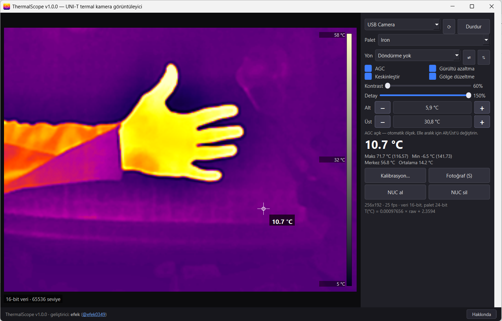
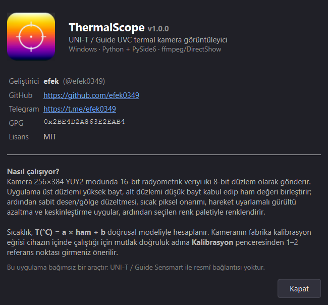

```
 ████████╗██╗  ██╗███████╗██████╗ ███╗   ███╗ █████╗ ██╗
 ╚══██╔══╝██║  ██║██╔════╝██╔══██╗████╗ ████║██╔══██╗██║
    ██║   ███████║█████╗  ██████╔╝██╔████╔██║███████║██║
    ██║   ██╔══██║██╔══╝  ██╔══██╗██║╚██╔╝██║██╔══██║██║
    ██║   ██║  ██║███████╗██║  ██║██║ ╚═╝ ██║██║  ██║███████╗
    ╚═╝   ╚═╝  ╚═╝╚══════╝╚═╝  ╚═╝╚═╝     ╚═╝╚═╝  ╚═╝╚══════╝
         S C O P E   //   U V C   I N J E C T I O N   K I T

root@thermal:~# ./thermalscope --target=uni-t --mode=radiometric
[+] payload captured // 65536 levels // no driver surgery required
```

**ThermalScope**, UNI-T / Guide UVC termal modüllerini Windows ve Linux da *gerçek* hâline
döndüren tek dosyalık bir görüntüleyicidir. Kamera uygulamasının gördüğü şey
sadece 8-bit gri bir video akışıdır; **gerçek veri** akışın içine gömülmüştür.
Biz onu çıkarıyoruz.




---

## `[00]` TRANSMISSION // NEDİR BU

```
 device ....... VID_0BDA:PID_5830  "USB Camera"
 uvc modes .... YUY2 256x192@25     <- kamera uygulaması bunu görür
                YUY2 256x384@25     <- gerçek veri burada
 payload ...... 16-bit radiometric, iki 8-bit düzlem hâlinde paketlenmiş
 decode ....... raw = (üst_yaka << 8) | alt_yaka
```

Cihaz 256×384 modunda 16-bit radyometrik kareyi YUY2 karesinin içine *planar*
olarak gömer. Bu depodaki kod o paketi söker, temizler, renklendirir ve
santigrat dereceye çevirir.

```
 YUY2 frame 256x384
 +---------------------------+
 | rows 000..191  HIGH byte  |--+
 +---------------------------+  +--> raw16 = (HIGH<<8) | LOW
 | rows 192..383  LOW  byte  |--+
 +---------------------------+
```

---

## `[01]` REQUIREMENTS // ÖN KOŞULLAR

```
[ ok ] Windows/Linux
[ ok ] Python 3.10+          python --version
[ ok ] PySide6 + numpy       python -m pip install PySide6 numpy
[ ok ] ffmpeg (DirectShow)   winget install Gyan.FFmpeg(Windows-11)
```

Kurulum yok, servis yok, registry yok. Klasörü kopyala, çalıştır, sil.

---

## `[02]` BOOT SEQUENCE // ÇALIŞTIRMA

```
  cd ThermalScope
  python ThermalScope.py  :: geliştirici modu
  python ThermalScope.py --install-desktop :: Linux Uygulama menüsüne ekleme
```

Açılışta cihaz kendiliğinden bulunur; bulunamazsa 4 kez daha dener
(kamera bazen önceki süreçten geç serbest kalır).

---

## `[03]` CONTROLS // KONSOL

```
 MOUSE ......... imleçteki pikselin sıcaklığı
 PALET ......... 10 palet, 256 adım
 YÖN ........... 0/90/180/270 döndürme + yatay/dikey ayna
 AGC ........... otomatik ölçek (min. 6 K pencere)
 ALT / ÜST ..... elle sıcaklık aralığı   [ - ] [ + ]  (0.5 °C adım)
 KONTRAST ...... S-eğrisi
 DETAY ......... DDE / keskinlik
 NUC al ........ lens kapalıyken sabit desen düzeltmesi
 S ............. fotoğraf  ->  Resimler\ThermalScope\
 R ............. döndürmeyi çevir        H / V ... aynalar
 ESC ........... çıkış
```

---

## `[04]` PALETTE BANK // RENK CEPHANESİ

`Iron` · `Rainbow` · `RainbowHC` · `Rainbow2` · `Rainbow3` ·
`WhiteHot` · `BlackHot` · `RedHot` · `Lava` · `Lava2`

Her palet **256 adım × 24-bit renk** (R8+G8+B8). Eski RGB565 tablolarındaki
32 seviyelik gri rampa bantlanması yok; `BlackHot` gerçekten beyazdan siyaha.

---

## `[05]` CALIBRATION PROTOCOL // SICAKLIK

Kamera sıcaklığı kendi içinde hesaplamaz: ham sayımı verir, fabrika eğrisi
cihazın içinde çalışır. Biz doğrusal bir modelle yaklaşıyoruz:

```
T(°C) = a * raw + b        default: a = 1/1024 , b = 2.359375
```

```
 [1] bilinen sıcaklıkta bir yüzey bul    (buzlu su 0 °C / vücut 36.5 °C)
 [2] imleci o yüzeye getir
 [3] Kalibrasyon... -> gerçek değeri yaz -> "Noktayı ekle"
 [4] ikinci nokta ekle -> Uygula         (a ve b birlikte fit edilir)
```

İki nokta arasındaki fark ne kadar büyükse fit o kadar iyi oturur.
Windows da Ayar `%APPDATA%\ThermalScope\settings.json` içinde kalır.
Linux da Ayar `$XDG_CONFIG_HOME/ThermalScope/settings.json` içinde kalır.

---

## `[06]` SIGNAL CHAIN // İŞLEM HATTI

```
 ffmpeg (dshow) --> YUY2 256x384 --> unpack 16-bit
                                        |
                          +-------------+--------------+
                          |  NUC / flat-field          |
                          |  hot-pixel repair          |
                          |  motion-adaptive temporal  |
                          |  spatial blur + unsharp    |
                          |  DDE (detail enhance)      |
                          +-------------+--------------+
                                        |
                          rotate / mirror --> AGC --> 24-bit palette
                                        |
                                     QImage --> ekran / PNG
```

Ölçüm her zaman ham kareden yapılır; filtreler yalnızca görüntüyü güzelleştirir.

---

## `[07]` KNOWN LIMITS // ZAAFİYETLER

```
[!] emissivity / mesafe / ortam sıcaklığı düzeltmesi YOK
    parlak metal gibi düşük emissivity'li yüzeylerde okuma düşük çıkar
[!] mutlak doğruluk: kalibrasyondan sonra tipik +-0.5...1 K
[!] kare hızı cihazın verdiği 25 fps ile sınırlı
[!] Windows Kamera uygulaması açıksa cihaz meşgul olur
[!] imzasız .exe'ler bazı sistemlerde kameraya erişemez -> .vbs/.cmd + Python
```

---

## `[08]` OPERATOR // İMZA

```
 operator .... efek0349  //  @efek0349
 github ...... https://github.com/efek0349
 telegram .... https://t.me/efek0349
 gpg ......... 0x2BE4D2A863E2EAB4
 license ..... MIT
 build ....... ThermalScope v1.0.4  ·  Python + PySide6 + ffmpeg
```

---

## `[09]` LEGAL // SORUMLULUK REDDİ

```
Bu araç bağımsız bir çalışmadır; UNI-T / Guide Sensmart ile resmî bağlantısı
yoktur. Cihazı yalnızca sahibi olduğunuz donanımda kullanın. Termal ölçümler
tıbbi, güvenlik veya sertifikalı ölçüm amacıyla kullanılamaz.
```

```
[ EOF ]  connection closed by remote host  //  0xDEADBEEF
```

